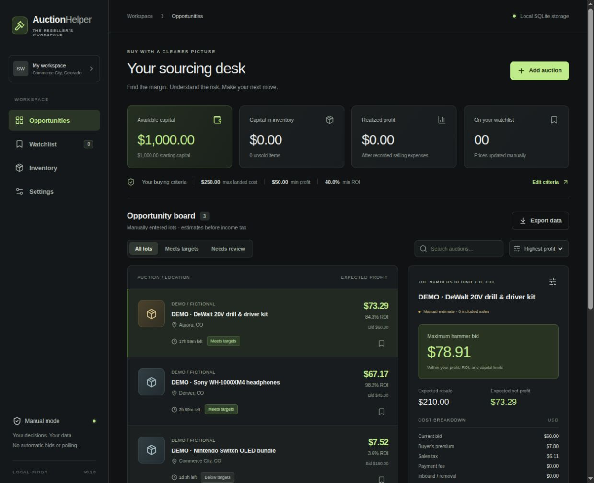

# Auction Helper

A local-first desktop sourcing desk for a solo reseller. **Rust + React/TypeScript + Tauri 2 + SQLite.**

This is the first usable milestone: manually enter an auction, attach sold-price evidence, understand the full cost, calculate a maximum bid, watch it, and record the purchase and sale. It works without cloud accounts or API credentials.

The local operations review branch also combines safe schema initialization,
inventory inspection notes, consistent workspace reads and source/comparable
evidence review. See [the integrated review and verification](docs/operations-quality-review.md)
for its exact scope, package evidence and dependency on the unmerged backup PR.
Current publication and CI status are recorded on the operations PR.

The separate local lifecycle branch adds manual inventory stages and complete
correction history, with Sold precedence and a recovery-first database/backup
version-two upgrade. See [lifecycle verification](docs/inventory-lifecycle-verification.md).
This slice is not included in published operations PR2.



## Run

Prerequisites: Node.js 24 LTS, npm, stable Rust (tested with 1.93.1), and [Tauri's Linux system dependencies](https://v2.tauri.app/start/prerequisites/). On Debian/Ubuntu these include `build-essential`, `pkg-config`, `libwebkit2gtk-4.1-dev`, `libgtk-3-dev`, `libayatana-appindicator3-dev`, `librsvg2-dev`, and `libssl-dev`.

```sh
npm ci
npm run desktop -- dev
```

For development in a browser, with the **same Rust engine and SQLite storage**:

```sh
npm run dev:browser
```

Open http://127.0.0.1:1420. The browser bridge is development-only, binds to loopback, and is not included in the production app. `npm run dev` by itself starts only Vite and is intended for the Tauri runner.

```sh
npm run desktop -- build           # Linux .deb package
npm run build                     # TypeScript + frontend production build
cargo test -p auction-core         # Financial boundaries and persistence
cargo clippy -p auction-core -- -D warnings
cargo check -p auction-helper      # Native desktop compile check
npx playwright install chromium   # First-time browser test setup
npm run test:e2e                   # Starts an isolated Rust/SQLite dev server
```

## What works

- Manual auction entry/editing: source link, category, location, deadline, condition, notes, bid and all cost assumptions.
- Comparable evidence with URLs, dates, conditions, shipping, sold/asking distinction, and inclusion controls. Only included sold observations determine the median resale price.
- Deterministic cent-based cost breakdown, profit/ROI, scenario range and maximum hammer bid. Defaults: $1,000 capital, $250 landed cost per lot, $50 profit, 40% ROI.
- Search, profit/ending-time sort, target filters, watch/unwatch and local countdowns. Prices are explicitly manual observations.
- Purchase and sale recording with atomic capital accounting, duplicate protection and a local action audit trail.
- Manual inventory stages from Unreviewed through Listed, backward corrections with history, and read-only last-stage history after a sale.
- Editable buying criteria, readable JSON export, and SQLite persistence across restarts.
- Dark UI with keyboard-accessible controls and dialogs; optional, labeled fictional examples.

“Open auction for manual bidding” opens the source URL. **The app never places a bid.** Recording a purchase or sale records an event that already happened; it does not transact with a marketplace.

## Storage

- Desktop: Tauri's per-user application data directory, `com.92swhite.auction-helper/auction-helper.db` (normally under `~/.local/share` on Linux).
- Browser development: `.local/browser.db`, or the path in `AUCTION_HELPER_DB`.
- Settings → Backup & restore downloads a complete, versioned local JSON backup (up to 1 MB), including lot evidence, watch state, inventory, criteria, stages and audit history. Files are validated before a review/confirmation step. Restore is atomic, rejects stale previews and saves a private recovery copy beside the database first. See [backup and recovery](docs/backup-restore.md).
- Existing v1 databases upgrade only after a complete, verified SQLite recovery copy is flushed beside the database. JSON exports use backup format v2; v1 imports explicitly map stages to Unreviewed.
- The older **Export data** action remains a readable analysis snapshot, not a restorable backup. For workspaces exceeding the JSON limit, close the app/bridge before copying the complete SQLite database.
- No credentials are collected or stored. The local database is not encrypted; it has the protection of the user's OS account.
- Sources & data includes a read-only manual capability catalog with dated documentation references and explicit unverified access. Custom source labels remain available when editing imported lots. See [source review evidence](docs/source-registry-verification.md); this catalog does not enable integrations.
- Expand **Review comparable evidence** in an auction's analysis to inspect saved dates, conditions, prices, shipping and inclusion. New observations start as Asking; marking a verified sale requires an explicit choice. See [review verification](docs/comparable-evidence-review-verification.md).

## Scope and limitations

This is an analysis and bookkeeping foundation, not the entire roadmap. No scraping, live price feeds, automatic comparable retrieval, bid execution, notifications, background monitoring, listing publishing, image recognition or route optimization is implemented. Acquisition and sale records remain immutable financial events; ledger correction, returns, additional expense entries and listing drafts remain future milestones. Manual operational stages do not change those financial records.

Fees are **user-entered assumptions**, not current marketplace fee schedules. New lots start with zero fees and an illustrative 5% returns reserve; verify all terms before using an estimate. The sample dataset is fictional. ROI is calculated on landed capital including travel and preparation; there is no prediction that an item will sell within 60 days.

The original research brief contains unverified access, legal, fee and earnings claims and a faulty example maximum-bid formula. It is preserved as input, not adopted as validated research. See [implementation decisions](docs/architecture.md), [financial model](docs/financial-model.md), [roadmap](docs/roadmap.md), and [original brief](docs/original-brief.md).

## Layout

```text
backend/core/       Rust valuation, validation, SQLite and development CLI
backend/desktop/    Tauri application, IPC and validated external URLs
frontend/          React interface, Vite development bridge, browser tests
migrations/        Versioned SQLite schema
schemas/           TypeScript IPC contract
docs/              Design decisions, financial rules, scope and roadmap
```

Rust owns the financial logic. The frontend formats returned values and collects inputs; it does not independently compute bids or ledger balances.
