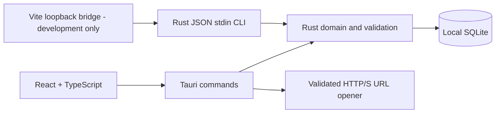

# Implementation decisions

Status: initial local-first milestone, 2026-10-26.

## Architecture

The core crate has no dependency on the desktop runtime. This makes financial logic and database workflows testable without a display server. Tauri holds a mutex-protected store in process. Browser development invokes a local CLI with fixed executable/path arguments and JSON on stdin; it does not use shell interpolation. It has an isolated database, loopback binding, JSON-only POST requests, origin validation, a request-size limit and a process timeout. It is not a production web server.

Rusqlite with bundled SQLite keeps the initial persistence layer small. WAL, foreign keys, a busy timeout and immediate transactions protect financial mutations. Version 1 stores typed lot inputs and comparable provenance in a JSON payload, with relational inventory, settings and audit tables. This is a deliberate MVP simplification of the brief's larger normalized schema; split out observations and comparables when query and source-monitoring requirements justify it. Migration 001 is idempotent. Future migrations must inspect and advance `user_version` rather than rerunning a fixed version marker.

## Command contract

Tauri `request(action, payload)` and the development CLI dispatch the same operations. Ordinary mutations return a complete `Snapshot`; restore also returns the automatic recovery file's path.

| Action | Payload | Result |
|---|---|---|
| `snapshot` | null | Settings, lots with analysis, inventory, balances |
| `analyze` | `LotInput` | Analysis without saving |
| `save_lot` | `LotInput` (null ID creates; existing ID edits) | Snapshot |
| `watch` | `{id, watched}` | Snapshot |
| `settings` | `Settings` | Snapshot |
| `purchase` | `{id: lotId, acquisitionCents}` | Snapshot |
| `sell` | `{id: inventoryId, grossCents, expenseCents}` | Snapshot |
| `backup` | null | Strict version-one backup of original records and audit history |
| `validate_backup` | `{text}` | Incoming counts, derived available capital, current audit revision |
| `restore_backup` | `{text, expectedRevision, confirmReplace: true}` | `{snapshot, recoveryPath}` after recovery-file creation and atomic replacement |

`open_url(url)` is a separate desktop command. It validates HTTP/S URLs, rejects embedded credentials and uses the OS browser. There is no bid-placement command and no marketplace credentials. Content is rendered by React without raw HTML insertion. Production CSP restricts scripts and connections to the packaged app/IPC; no remote scripts, fonts or images are needed.

The authoritative domain types live in `backend/core/src/model.rs` and the strict backup envelope/requests in `backend/core/src/backup.rs`. `schemas/domain.ts` remains a manually maintained matching IPC contract. Browser integration tests exercise the actual Rust boundary; type generation remains future work. Backup files contain no derived analysis/totals, and restoration recomputes those values. See [backup/restore design](backup-restore-plan.md) and [user recovery guide](backup-restore.md).

## Source feasibility decisions

The supplied report is retained with trailing whitespace normalized in `original-brief.md`. Its claims are not treated as permission to automate a source or as verified economic/legal advice. No auction page is fetched by this milestone. Dickensheet, PublicSurplus, GovDeals and other sources support manual URL/detail entry. Comparable evidence supports manual entry from sources the user can legitimately access.

Official eBay documentation distinguishes inventory browsing from sold-price research. [Browse search](https://developer.ebay.com/api-docs/buy/browse/resources/item_summary/methods/search) is not an assumed general sold-comparable feed. The [Marketplace Insights overview](https://developer.ebay.com/api-docs/buy/marketplace-insights/overview.html) redirects to a private sign-in-gated API area. An implementation must verify actual account entitlements before promising automated sold research. An active listing must never be silently represented as a completed sale.

No legal licensing thresholds, projected earnings, current marketplace fees or source scraping permissions from the report are encoded as facts. Fee inputs are user-confirmed and zero by default, except for an explicitly illustrative returns reserve. Data access, credentials, rate limits and fees will be evaluated per adapter before implementation.

The desktop setup follows the [official Tauri Vite integration](https://v2.tauri.app/start/frontend/vite/). The UI uses local CSS design tokens and Lucide icons rather than pulling in a large component toolkit for four screens. Native dialogs provide focus containment and Escape dismissal.

## Privacy and deployment

All auction and financial data remains in the local SQLite store. No telemetry or network requests are performed by the application itself. Opening a source URL deliberately navigates the user's browser. Credentials/OS-keychain integration are deferred until an approved integration needs them. The database is not encrypted at rest by this app.

The first supported build target is Linux. CI checks the core, frontend, browser workflow, and a native Tauri compile. Signing, cross-platform packaging, app updates and production distribution are follow-up tasks. Monitoring can only operate while a future local scheduler is running; an external notification relay cannot itself discover local events while the computer is asleep.
