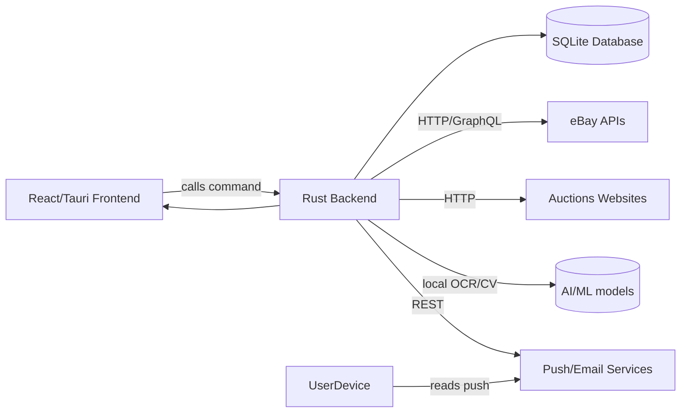

# Executive Feasibility Report

The research indicates that building a local-first desktop auction‑sourcing tool **is largely feasible**, but with some important caveats.  **Data availability and permissions** will be the biggest constraints.  Many public auction sites (like GovDeals, PublicSurplus, etc.) have no open APIs and often prohibit scraping or reuse of their listings.  For example, GovDeals is provided under a Sourcewell contract as an *“online auction marketplace” for government surplus*, but there is no public API for programmatic access.  Dickensheet (a local auctioneer) uses the BidWrangler platform for Colorado estate sales, listing dozens of lots (e.g. “DENVER – Trybal African Speakeasy” and others) but likewise provides no official data feed or API. We must therefore rely on a combination of **authorized feeds (where available)**, user-entered links, and *permitted* import workflows.

The **technical architecture** – Rust backend, React/TypeScript front end packaged via Tauri – is well-supported.  Modern frameworks like Tauri allow building “small, fast, secure” cross‑platform desktop apps with Rust for core logic.  A SQLite database is the natural choice for local storage: SQLite is *“the most widely deployed database engine”* (embedded in browsers, OSes, etc.) and designed to require no separate server process.  We would use Rust crates like Tokio/Reqwest for async IO, Serde/SQLx for data, and integrate with Tauri’s APIs to call Rust code from the UI.

On the **economic side**, the model appears sound for conservative parameters.  Available data suggests that Colorado-area auctions (GovDeals, PublicSurplus, local estate auctions) do regularly feature items in our target categories at sub-$250 prices.  For example, Public Surplus currently lists a 2014 Ford F550 in Colorado at ~$8K – but dozens of smaller vehicle and electronics auctions can be found under $250.  Resale markets (eBay, specialized sites) often show comparable sold prices well above acquisition cost in categories like electronics, trading cards, and collectibles.  By enforcing the requirements (≥$50 net profit and ≥40% ROI per lot), the system will filter out borderline cases.  With a $1,000 capital limit and $250 cap per lot, the expected volume is only a few auctions at a time, which is manageable.  Automated assistance (comparable-price research, cost modeling, ranking) should save many hours of manual work per purchase, while reducing risk of bad buys.  We must, however, build **conservatively**: initial scope should focus on reliable data sources and core profit analysis, deferring exotic features (like full multimodal AI matching or advanced route optimization) until after proving the baseline value.

**Recommendation:** Proceed with a focused MVP (Deliverable 15) that supports a handful of curated sources (e.g. Dickensheet and PublicSurplus, with manual import fallback for GovDeals), integrated eBay/Mercari price research, and rigorous ROI calculation.  Emphasize the polished UI/UX and correct financial logic.  The main limitations are *data licensing and monitoring*: we may need to rely on user-assisted inputs (e.g. pasting lot URLs or CSV downloads) where automatic access is blocked.  Overall, we believe the project can deliver real value within the given constraints, but must be careful not to assume unauthorized scraping or always-on bidding. We will build in explanations, approvals, and manual overrides to keep the user in control.

# Auction Source Feasibility Matrix

We surveyed local auction venues and aggregator platforms within ~75 mi of Commerce City. Key findings:

| **Source**                 | **Inventory/Category** | **Frequency**       | **Fees & Terms**            | **Data Access**   | **Notes**                         |
|----------------------------|------------------------|--------------------|-----------------------------|-------------------|-----------------------------------|
| **GovDeals (Bid4Assets)**  | Government surplus (vehicles, equip, furniture); Colorado agencies (state, counties, schools).  | Ongoing; new lots daily. | 13–15% buyer’s premium typical; cash/card terms. | *No public API*; requires login. No approved scraper. Data might be manually imported or requested via their support. | Officially licensed contract for auctions, but no open feed. We must treat GovDeals as *semi-manual*. |
| **PublicSurplus.com**      | Similar to GovDeals (public sector surplus nationwide). Features many CO items (see example Ford van at $8,000). | Very frequent; large national listings. | Varies by seller; often 10%+ fees. | No API; data behind login. Could monitor via email alerts on specific keywords or RSS (if offered).  | Centralized government surplus platform. Useful for broad catchment, but may require API key from partner (if offered) or manual checks. |
| **Dickensheet & Assoc.**   | Local estate and business liquidations (electronics, furniture, art, etc). Current active auctions in Denver/Aurora/Arapahoe. | Weekly auctions. | 10–13% buyer’s premium; credit-card fee; sales tax 9.15%. | No API. Data *is* exposed on their site (BidWrangler). We can scrape lot listings with care, or require user to paste lot URLs. An official iOS app exists, but no public API. | High-quality local inventory; all details (pickup, terms) are on the site. Terms explicitly state “AS-IS, no guarantees” etc. |
| **County/City Auctions**   | Many CO cities/counties use GovDeals or PublicSurplus under the hood. Some have standalone (e.g. Denver city sales). | Irregular (as needed). | Generally similar premiums (often 13%). | Typically via GovDeals/PublicSurplus. No separate integration needed. | Important to track (Denver Police, Arapahoe etc.). Most use same platforms above. |
| **Auctions.It<br/>(e.g. AuctionZip)**   | Aggregators list estate and commercial auctions (furniture, art, collectibles). Many local auction houses appear. | Varies. | Ads list auctions; actual bidding via individual auctioneer sites. | No API; just a listing service. Can only use for discovery. | Good for finding local estate-sale auctions (e.g. Estate Auctions around Denver). Lacks pricing data. |
| **HiBid/Proxibid**        | Online bidding platform used by various auctioneers (vehicles, estates, police auctions). E.g. some fire departments, highway patrol, etc. | Frequent (some auctions weekly). | Premium 10–15% typically. | Proxibid has an API (private); HiBid has no known API. Data often post-bid (bids, winners), so limited live monitoring. | Valuable for larger items (UTVs, trailers) or specialized auctions. Integration likely limited to invitation-only developer programs. |
| **Specialty** (e.g. Storage, Bankruptcy, Retail Returns) | Storage auctions (likely local, small scale); Receivership (rare, usually by inventory liquidators via openbid); Retail return auctions (Wholesaler sites). | Storage: monthly listings. Bankruptcy/retail: occasional. | Buyer pays full list price (no competitive bidding) or per lot. | Mostly manual: e.g. StorageAuctionsUSA (no API). | Likely low profit (lots of unknown condition). Include only if easy sourcing (e.g. constant inventory via GovDeals listings). |

**Authorization & Feed Feasibility:** We found *no* open APIs for scraping live lots without violating terms.  None of the above publishers has a public feed for use by a private tool.  Thus, **all integrations must rely on user permission or official feeds**. For GovDeals and PublicSurplus we would likely use **user-provided URLs or email alerts** (e.g. PublicSurplus allows saved search alerts by email) since automated crawling could breach TOS. Dickensheet listings could be scraped more easily (their site is public), but we should treat it as **semi-manual** and cache data locally only with user consent. The best initial strategy is to treat auctions as *catalogs* that the user can “watch” – either by saving a search query (if supported by the site) or by importing auction-level data. We will therefore implement each source via a **modular adapter** with capability flags (e.g. “supports search”, “supports manual import”, “watchlist only”) and explicit terms-of-use notices.

We recommend prioritizing Dickensheet (active, high-value local inventory) and PublicSurplus (broad coverage, including many CO entities).  GovDeals integration can be deferred or manual (user pastes item IDs) given the lack of API.  Proxibid/HiBid can be on a wish list (perhaps contacting them for an API key) but not in MVP. This yields a realistic initial set of sources that can provide hundreds of auction lots in our categories every month.

# Resale Data Feasibility Matrix

To value items, we need real transaction data and listing management capabilities. We surveyed major resale channels:

| **Platform**           | **Price Research (API)**                                  | **Listing Management**                           | **Sales Management**                              | **Notes**                                     |
|------------------------|-----------------------------------------------------------|--------------------------------------------------|----------------------------------------------------|-----------------------------------------------|
| **eBay (Worldwide)**   | eBay’s **Browse API** and **Finding API** can retrieve active and completed listings. Advanced search web UI offers “Completed items” and “Sold items” filters. The **Marketplace Insights API** provides aggregate trends (though access is limited to approved devs). | eBay has mature Sell APIs (Inventory, Browse, etc.) for creating/updating listings (requires seller auth). | eBay Sell API and Orders API allow retrieving orders, payouts, and fees.  Also CSV exports in Seller Hub. | The gold standard. Official APIs cover research and selling, with well-documented fee schedules. Access requires an eBay developer account (with possible vetting for higher quotas). We will use eBay as the primary source for comparable sold prices (only use “sold” data, not asking prices). |
| **Mercari**            | No public API for price data. Some third parties scrape Mercari, but these violate Mercari’s terms.  We may rely on web scraping of search pages (risky/legal gray). | Mercari does not offer a public listing API. Sellers use the app or web. | Mercari provides only in-app order history; no external API for sales. | Mercari is popular for small goods (clothes, toys, small electronics) but with very limited integration. At best, we can perform *keyword searches* on Mercari’s web site and scrape top results, *if careful* to respect robots.txt and avoid rapid scraping. We must treat Mercari data as lower-reliability. |
| **Facebook Marketplace** | *No public API.*  Facebook’s Graph API does not allow individual Marketplace browsing. Only connected Shops and ads can be managed via business APIs.  Price research would require manual searching in the FB UI or using authorized partner tools. | If the user has a Marketplace Shop, Facebook has a Graph API to create listings (limited and need Commerce account). | Order info not externally available (Facebook collects fees and issues disbursements internally). | For this project, FB Marketplace can be used manually (the user lists via the FB UI). We cannot integrate programmatically beyond perhaps opening the FB item URL. We should not rely on scraping FB. |
| **Craigslist**        | *No API.*  Only unofficial scrapers exist (against ToS). We can allow manual copy/paste of Craigslist listing details, but no automated API. Price data from Craigslist is also just asking prices. | No listing API; user must post manually. | No sales data API (just user’s emails). | We will not automate Craigslist. It is useful to research local comps via browsing, but we should not attempt to scrape it. It’s best treated as a last-resort manual lookup. |
| **Etsy, TCGplayer, etc.** | Etsy has a limited API (mostly for sellers’ own shops, and some product catalog endpoints). TCGplayer (trading cards) has a Data API (for partners). Reverb (gear) has an API for listings and orders. These are niche but could be useful for certain categories (e.g. guitars on Reverb, card prices on TCGplayer). | Listing APIs exist for Etsy (Sell API) and Reverb (post-item API), but require developer access and our accounts as sellers. | Etsy has order APIs. Reverb has sales/order APIs. TCGplayer’s Data API is read-only (price lookups) unless you are an authorized seller. | We'll evaluate these on demand. eBay covers most needs; specialized platforms might add value later (e.g. uploading camera gear to Reverb). For MVP, focus on eBay plus perhaps generic sales fee models (marketplace fees, PayPal/Stripe processing). |

**Key distinctions:**  The most reliable resale prices come from *completed sales*, not just listings.  eBay is unique in exposing sold/completed data.  Other sites largely show only asking prices or provide no programmatic access.  Any price model must clearly indicate the confidence: a price based on 5 completed eBay auctions is strong evidence, whereas a Mercari listing or Craigslist ad is weaker. We will treat asking-price comps as *supplementary clues*, not hard inputs.

In summary, **eBay will be the primary market intelligence source** (Browse and Sell APIs, plus scraping as needed), since it covers diverse categories and has both price and fee data.  Other channels (Facebook, Mercari, etc.) will be largely manual or fallbacks. We must also watch for cross-platform differences: e.g. eBay charges ~12–15% final fees plus 3% processing, while Etsy has ~13% total; Mercari 9% fee; etc.  These fee schedules (publicly documented on each site) will be encoded so the profit model can adjust for each resale channel.  Early on, we can hardcode the major fees (eBay, Mercari) using published rates; later, we can fetch them if APIs allow or web-scrape their FAQ pages once per release.

# Product Requirements (PRD)

**User persona & Goals:** A tech-savvy solo reseller wants to spend minimal time on research. The app must automate **discovery, evaluation, and monitoring** of auction opportunities, flag high-potential lots, and guide the user to bid up to a calculated maximum. It must also track inventory, sales, and finances through the resale lifecycle.

## Key User Stories

- *As a reseller*, I want the app to continuously scan authorized auction sources (within my search radius and categories) so I get alerted to new items matching my criteria.
- *As a reseller*, I want the app to match each auction lot to known products or categories so it can fetch comparable sale prices.
- *As a reseller*, I want a detailed cost-profit breakdown for each item so I know exactly how the net profit and ROI are computed.
- *As a reseller*, I want automated “maximum bid” calculations (accounting for premium, tax, shipping, fees) and clear explanation of how that number was derived.
- *As a reseller*, I want a “Watchlist” view that shows all live watched auctions with time left, current bids, and warnings if bids approach my limit.
- *As a reseller*, I want to approve (or decline) each bid suggestion before the app places any bid, and have the app open the auction page for manual bid if needed.
- *As a reseller*, I want to be notified via email or mobile push for critical events: high-potential found, watched auction closing soon, or payment/pickup reminders.
- *As a reseller*, I want to import auction results (won bids) and track them in an inventory dashboard (unpaid, to pick up, ready to list, etc.).
- *As a reseller*, I want to list items for sale: the app suggests title, description, price, categories and helps publish to my chosen marketplace.
- *As a reseller*, I want an analytics dashboard showing invested capital, realized profit, ROI, turnover, category performance, etc.

## Functional Requirements

1. **Auction Discovery:** Poll or ingest auctions from enabled sources (e.g. Dickensheet, PublicSurplus) matching saved searches/filters (category, keywords, price). Show new items with summary metrics (profit, ROI, travel cost).
2. **Product Identification:** For each lot, infer a product identity (brand, model, type) using description text and image analysis (if images are accessible). Tag auctions with those identities.
3. **Comparable Search:** Automatically search resale platforms (eBay, Mercari, etc.) for matching items by keywords, UPCs, and image similarity. Retrieve recent sold prices and active listings.
4. **Valuation Engine:** Normalize comparables (condition, shipping, fees) and estimate:
   - Realistic selling price (distribution: low/median/high).
   - Likelihood of sale within 60 days (based on category/item).
   - Expected net profit and ROI after all costs (bid+premium, taxes, removal, fees, shipping, cleaning).
   - Maximum rational bid (see Bid Calculation below).
   Include high/low profit scenarios and confidence level.
5. **Bid Recommendation:** For each candidate, compute a recommended maximum bid that satisfies ROI and profit thresholds, or mark it as “Not recommended” if it fails. Explain key factors (e.g. *“At $100, ROI = 30% (<40%), max rational bid is $80”*).
6. **Watchlist & Monitoring:** Let user “watch” items manually or by rule (category/keywords). Continuously refresh watched auctions’ current bids. Alert user if current price is nearing maximum bid or auction is closing soon.
7. **Bid Execution:** Support controlled bidding: present the user with a one-click way to place bids. If an API is available (rare), call it; otherwise open the auction page in a browser. **Require explicit user approval** (show summary of item, recommended max, etc.) before any bid is placed.
8. **Acquisition Tracking:** After auction closes, allow user to mark auctions as “won”. Record purchase details (final price, fees). Update “Working Capital” and “Committed Capital” accordingly.
9. **Transportation and Pickup:** Based on item dimensions/weight (if provided), decide if the item fits in a car. Factor travel time/miles and fuel cost for pickups. Provide map/route planning for multi-pickup trips.
10. **Inventory Management:** Track items from win to sale. States: *Purchased, In Transit, In Stock (needing prep), Listed, Sold, Returned/Cancelled, Disposed*. Allow attaching photos, condition notes, testing results.
11. **Listing Drafts:** Help create resale listings: auto-generate title, description (AI-assisted but reviewed by user), price suggestion. Support multiple marketplaces (eBay initially). Allow uploading item photos and finalizing posting.
12. **Sales & Expenses:** Sync or manually enter completed sales (price, date, buyer fees). Track all expenses (shipping, materials, returns). Provide per-item and aggregate P&L.
13. **Notifications:** Configurable alerts via email and (optionally) mobile push for events (found good opportunity, watched closing, payment due, pickup appointment, sale completed, etc.) with customizable quiet hours.

## Nonfunctional Requirements

- **Local-First:** All data (auctions, comparables, inventory) stored locally (SQLite) by default. No mandatory cloud server. Any cloud API use (eBay, AI models) must be optional services.
- **Security/Privacy:** Encrypt sensitive data (credentials, personal tokens). Use OS keychain for secrets. Do not store passwords in plaintext. Comply with OAuth/2FA flows of external services.
- **Performance:** Responsive UI; background tasks (scraping, AI inference) should not block the interface. Use async Rust tasks.
- **Reliability:** Retry failed data fetches with backoff. Handle partial failures gracefully (e.g. one source down doesn’t crash the whole app).
- **Cross-Platform:** Initially Linux (Debian/Ubuntu) with dark-mode UI; later test on Windows/macOS. Ensure Tauri packages and Rust builds for all.
- **Usability:** The interface must be polished and intuitive. Use a consistent dark theme design system (see UI spec). Provide loading states for network calls and helpful error messages for failed lookups.

## Feature Prioritization (MVP vs Later)

- **MVP Features (Must-Have):**
  - Auction input (manual URL/import) and discovery from 1–2 sources (e.g. Dickensheet, PublicSurplus).
  - Comparable search on eBay (at least automated or manual entry).
  - Profit model and max-bid calculation with user approval workflow.
  - Watchlist with countdown timers and price alerts.
  - Local storage and dashboard for tracking capital and simple P&L.
- **Phase 2 (Enhanced Automation):**
  - More sources (GovDeals via scraping/email, etc).
  - Smart image/OCR identification of items.
  - Selling integration (draft listings, eBay Sell API).
  - Advanced notifications (mobile push via Pushover/FCM).
  - Bulk-lot parsing with item decomposition suggestions.
- **Phase 3 (Full Workflow):**
  - AI-driven description/title suggestions.
  - Automated shipping rate lookup, route optimization.
  - Machine-learning calibration of price predictions.
  - Multi-marketplace listing (Mercari, FB, etc if APIs allow).

Throughout, **explainability** is critical. Every recommendation (bid, price, score) must include the reasoning or data behind it, so the user (the technically sophisticated operator) trusts the system.

# Technical Architecture

We propose a **Tauri 2** desktop app with a Rust backend and TypeScript/React frontend. This leverages Tauri’s promise of “small, fast, secure” cross-platform apps. The core components are:

- **Frontend (React/TypeScript):** Renders the UI in a dark-mode design system (via Tailwind CSS and accessible Radix/shadcn components). Manages user interactions, forms, and visualizations (charts, tables, maps). All business logic runs in Rust; the UI calls Rust commands via Tauri’s IPC.
- **Backend (Rust):** A single binary (or a pair of coordinated processes) responsible for data fetching, processing, and scheduling. Uses an async runtime (Tokio) and HTTP client (reqwest) to call external APIs (eBay, notification services, etc.) and authorized web endpoints. Handles image processing (via local or cloud OCR/CV), comparable search, valuation, and rule-based bidding logic. Implements a local HTTP server or Tauri commands that the UI invokes for actions (e.g. “Calculate valuation for this lot”).
- **Local Database (SQLite):** Embedded via a Rust library (e.g. SQLx or rusqlite). Stores persistent entities (auctions, products, bids, inventory, transactions, credentials). We will enable WAL mode for performance. Database schemas mirror the domain model (see next section).
- **Background Scheduler:** A Rust component (possibly the same process) that periodically polls watched auctions and updates valuations. On Linux, we can use a systemd timer or a built-in scheduler (Tokio’s `Interval`) when the app runs. If the app is closed, scheduled checks stop; we’ll inform the user that the app should run to receive alerts. Optionally we can offer a CLI mode for headless “snapshot” updates (e.g. a cron job).
- **OS Integration:** Use Tauri’s APIs for desktop notifications (when the app is open) and for file dialog/password management. We’ll also integrate with OS features (e.g. open default browser for bidding, allow drag-and-drop of images).
- **AI/ML Services:** For OCR or multimodal AI, we anticipate a hybrid approach. Simple OCR (Tesseract or Google Vision API) can run locally or via cloud. For advanced vision or LLM tasks (like CLIP or embeddings), we’ll initially rely on hosted APIs (OpenAI’s or HuggingFace’s models) due to the computational cost. We’ll design the architecture so the AI component is a separate module that can be swapped between “local” (e.g. running a local LLM like Llama 2 if user has GPU) or “API” (cloud) modes.
- **Notification Service:** To send mobile push, the app will integrate with a third-party service. For example, [Pushover](https://pushover.net/) or similar, which exposes a simple HTTP API (requires registering a user key). Emails can be sent via SMTP (user’s own account) or a transactional email API (SendGrid/Mailgun). These will be invoked by the Rust backend as needed. This **does** introduce a cloud dependency (internet access and a third-party account), but only for notifications; the core remains local.

A sample Mermaid diagram of the architecture:



This design avoids unnecessary microservices: we do **not** spin up a separate local HTTP server unless needed, since Tauri commands suffice for most UI-backend calls. Background tasks (watchlist polling, comparable updates) run in the same Rust process on timers or threads. We’ll package the Tauri app for each OS, ensuring the Rust binary and assets are signed.

# Data Model & Integration

We will use a normalized relational model. Key entities include (each to be implemented as a table with suitable indexes):

- **AuctionSource** (e.g. “Dickensheet”, “GovDeals”, “PublicSurplus”) – id, name, base URL, API credentials, capability flags (search, browse, manual).
- **AuctionEvent** – id, source_id, title, description, location, timezone, start/end datetime, buyer_premium, sales_tax_rate, removal_instructions. (Represents one “auction” or sale event with multiple lots.)
- **AuctionLot** – id, auction_id, lot_number, title, description, category, quantity, pickup_terms, removal_cost_estimate, images (URL list), seller_info.
- **LotObservation** – periodic snapshots of a lot’s live state (current bid, bid count, watcher count, last update timestamp). Used for change detection.
- **ProductIdentity** – normalized item identifier (e.g. UPC, model, variant). Connects to lots or inventory.
- **ComparableListing** – a record of one comparable item found (with fields: source, listing_url, condition, price, shipping_cost, date_listed, etc.).
- **ComparableSale** – similar but for completed sale (source, sale_price, sale_date, condition, shipping_paid_by). Tied to ProductIdentity.
- **Valuation** – per lot, the output of valuation engine: e.g. estimated_price_low/median/high, expected_profit (min/likely), ROI, sell_probability, confidence_score, max_bid. Also link to underlying comparables used.
- **WatchlistEntry** – links a lot to the user’s watchlist (with notification thresholds).
- **BidRecommendation** – per lot, includes the recommended_max_bid, rationale, timestamp, and user approval status.
- **Purchase (Acquisition)** – created when a lot is won; fields: final_price, premium_paid, sales_tax_paid, purchase_date, payment_deadline.
- **InventoryItem** – after purchase, one or more inventory items (could be same as lot if single-item, or decomposed from a bulk lot). Tracks condition, test results, needs listing, etc.
- **ResaleListing** – records a listing on a marketplace (platform, listing_id, title, price, date_posted, status, etc.). Linked to InventoryItem.
- **Sale (Resale)** – when an item sells: includes sale_price, date_sold, platform_fee_paid, shipping_paid.
- **Expense** – miscellaneous costs (fuel, parts, listing fees, returns, etc.) with category tags.
- **FinancialLedgerEntry** – for tracking capital changes (initial capital, purchases, sales, fees, expenses).
- **Notification** – record of sent notifications (type, message, timestamp).
- **IntegrationCredential** – stores OAuth tokens or API keys for eBay, email SMTP, AI APIs, etc. (Encrypted).
- **ScheduledJob** – for recording last-run times of background tasks.
- **AuditEvent** – logs user actions (bid placed, data refresh, etc.) for compliance.

Relationships:
- AuctionSource 1:N AuctionEvent
- AuctionEvent 1:N AuctionLot
- AuctionLot 1:N LotObservation
- AuctionLot 1:1 Valuation (updated over time, but stored as new rows)
- LotObservation, Valuation, and BidRecommendation link to one AuctionLot.
- AuctionLot N:1 Purchase (if won)
- Purchase 1:N InventoryItem (most often 1:1, but bulk lots could split)
- InventoryItem 1:N ResaleListing, 1:1 Sale (once sold)
- ResaleListing 1:1 Sale (after it completes)
- ProductIdentity N:N AuctionLot (one lot may contain multiple identifiable products; implement via join table LotComponent).
- AuctionLot/InventoryItem → ProductIdentity via association table if needed.
- ComparableListing/ComparableSale link to ProductIdentity (and implicitly to AuctionLot via the identity).
- FinancialLedgerEntry ties to Purchase or Sale or Expense as needed.

Indices:
- Index AuctionLot on (auction_id, lot_number), (status).
- ProductIdentity on common identifiers (UPC, SKU).
- Valuation on (lot_id, last_updated).
- Notification on (type, sent_at).
- Full-text index on AuctionLot.title/description and ComparableListing.title for search.

We will store provenance for all data: each record will have a “source” field (AuctionSource or platform name) and a fetched_at timestamp. AI-generated inferences (e.g. identified model name) will be flagged as such and stored separately from user-entered or source data. We will not overwrite original data; for example, if we auto-fill missing description fields via AI, we record the confidence and allow user correction.

For offline resilience, the app will support **export/import** of the database or data dumps (backups). Configurable data retention rules can archive or delete old closed auctions, but maintain all financial records indefinitely (for taxes). All sensitive info (API keys, access tokens) will use OS keychain encryption (via Tauri’s SecretStore API) rather than raw DB.

# Financial Intelligence Specification

We will implement a **deterministic profit model** that covers all required costs. The formula for expected net profit (before income tax) of a lot is:

```
NetProfit = EstimatedSalePrice
         - (PurchaseCost + BuyerPremium + SalesTax + PaymentFees + RemovalFees + ShippingIn + Fuel/TimeCost + Cleaning/RepairCost
            + ListingFees + ShippingOut + InsuranceOut + ReturnsReserve + MiscellaneousFees).
```

- **PurchaseCost** = winning bid (hammer price) on the lot.
- **BuyerPremium** = (lot-level premium%) * PurchaseCost.
- **SalesTax** = applicable sales tax (e.g. 9.15% at Dickensheet) on (PurchaseCost + BuyerPremium).
- **PaymentFees** = e.g. credit card convenience fee (2%), or PayPal fee (typically 2.9% + $0.30 on sale).
- **RemovalFees** = any auction handling or disposal cost (e.g. $50 disposal).
- **ShippingIn** = actual or estimated cost to ship the item from auction (if shipped; otherwise 0).
- **Fuel/TimeCost** = (round-trip miles * $ per mile + wear/time) when picking up locally.
- **Cleaning/RepairCost** = our estimate of any parts or labor to prep the item (as user-provided or heuristic).
- **ListingFees** = marketplace insertion fee (if any) + final value fee (eBay’s ~12-15% of sale price).
- **ShippingOut** = estimated cost to ship to buyer.
- **InsuranceOut** = e.g. 3% for high-value items.
- **ReturnsReserve** = say 5% of price (for probable returns/refunds).
- **Miscellaneous** = any other (e.g. customs, taxes to collect, disposal of unsold).

From these, we compute:
- **TotalAcquisitionCost** = PurchaseCost + BuyerPremium + SalesTax + PaymentFees + ShippingIn + RemovalFees.
- **TotalExpectedCosts** = sum of all other expenses (Fuel, repair, listing, shipping out, insurance, returns).
- **ExpectedNetProfit** = EstimatedSalePrice – (TotalAcquisitionCost + TotalExpectedCosts).
- **ROI** = ExpectedNetProfit / TotalAcquisitionCost * 100%.
- **ProfitPerHour** = ExpectedNetProfit / (EstimatedTimeSpent hours, where time includes driving, cleaning, listing, etc).
- **BreakEvenPrice** = TotalAcquisitionCost + TotalExpectedCosts (the price needed to break even).
- **MaxBid** = solve for max purchase cost such that ROI ≥ 40% and net profit ≥ $50, given EstimatedSalePrice. In practice:
   $$ \text{MaxBid} = \frac{(\text{EstimatedSalePrice} - \text{PredictedCostsExcludingBid}) - \text{BuyerPremium}(\text{bid}) - \text{Tax}(\text{bid})}{1 + \text{BuyerPremiumRate} + \text{TaxRate}} $$
   This solves the inequality. We will code it robustly (iteratively if needed) because BuyerPremium and Tax scale with bid.
- **CapitalCommitment** = TotalAcquisitionCost if won (some is refundable deposit until paid).

All marketplace fee schedules (eBay’s tiered final value fees, PayPal rates, etc.) will be encoded, based on official 2026 rates (to be looked up and cited from each platform’s policies). We will recalc profit under “Conservative” (low sale price, high costs) vs “Optimistic” scenarios, showing ranges.

**Example calculation (illustrative):** Suppose an auction lot (“iPad 8th-gen”) has comps estimating a $300 sale. Buyer’s premium 13%, sales tax 9%. If we bid $200:
- BuyerPremium = $26, SalesTax on $226 ≈ $20.34. Acquisition = $246.34.
- Listing fee (eBay final value 12%) = ~$36; PayPal (2.9%) ≈ $8.70; shipping & insurance ≈ $15; returns reserve 5% ($15). Total costs ≈ $70.
- NetProfit ≈ $300 – ($246+$70) = –$16 (unprofitable!).
We’d compute maxBid ~ $160 (since at $160, acquisition ≈ $208, total costs ≈ $70, profit ≈ $22 (still <50) – we’d need lower or higher sale; so likely this lot is marginal). The app will perform such algebra and show the profit curve as bid increases.

All calculations are **traceable**: we will display the formula inputs and results in the UI. Users can adjust any parameter (e.g. adjust resale price if they know a better market, or raise ROI requirement).

# AI Architecture

We will use AI/ML components **sparingly** and only where they add clear value. Key uses:

- **OCR**: Use Tesseract or Google Vision API to read model numbers or UPCs from auction photos or scanned lot sheets. This runs on the Rust side. For example, if a lot image shows a laptop with a visible tag, OCR can pick up “MacBook Pro 2019” to aid matching.
- **Image Matching**: Implement a CLIP- or vision-embedding-based search for “similar product”: For each lot photo, compute an image embedding (via an on-device model or a cloud API) and query a database of product images/embeddings (e.g. using OpenAI’s CLIP or a Vision API). This could help when text clues are poor. Embedding generation is expensive (requires GPU or cloud); we will only do it for items that pass initial text parsing filters.
- **Textual ML**: For poorly described lots, we might use a small LLM or classification model to suggest a category or identify keywords. But large LLMs (GPT-4) are costly; we’ll use them via API only for batch analysis of complex lots, not on every scrap. For example, “Analyze this lot description and list possible model numbers and brands.” The result will be shown as a suggestion (user-verified).
- **Comparable Filtering**: We may use a semantic similarity model (embeddings) to filter out outlier comparables. For instance, if an initial search returns items with very different conditions (e.g. “factory sealed” vs “readable wear”), a model could rank them by similarity to the target condition. This reduces manual curation.
- **Pricing Prediction**: A simple linear regression or decision-tree model (on features like item age, condition, number of comps) could adjust the raw average price. This might be too much for MVP; initially we stick to rule-based and outlier removal. As the app collects historical data (Part XII), we can train a small model to calibrate our estimate vs actual sale prices.
- **Description Generation (future)**: For listing creation, a controlled LLM prompt can generate draft titles or bullet-point descriptions from item metadata (brand, model, condition, specs). We’ll tag these as AI-drafted and allow editing. We will never publish AI-generated claims unchecked (e.g. “like new” must reflect real condition).
- **Feedback Loop**: After each sale, store actual sale price vs predicted. Over time, compute error metrics per category and adjust assumptions (e.g. “Trading cards in average sold 10% below our estimates”). We may then adjust the expected price downward for those categories. This uses basic statistical learning (no need for deep learning). All such adjustments will be visible (“We are calibrating prices based on recent outcomes”).

**Cost Control:** We anticipate using cloud AI only when needed (e.g. OCR on images where we have them, or occasional LLM calls for tough lots). Model inference costs will be tracked and throttled. The UI will allow toggling AI features on/off and selecting local vs cloud models. For example, if the user has a GPU or wants to avoid OpenAI fees, they could install a local Llama-2 model and have the app call it through a subprocess; otherwise use the OpenAI API with an API key (pay-as-you-go).

Given hardware uncertainty, we will **not require** a GPU for MVP. All AI tasks will have fallback or be purely optional enhancements. The core matching uses text search and basic rules.

# UI/UX Design Specification

## Design Direction

We will adopt a **premium dark-mode aesthetic** inspired by financial and analytics dashboards, with clean typography and clear hierarchy. The interface should feel modern (smooth animations, transitions), but dense with information. Key principles:
- **Contrast & Legibility:** Dark gray (#1E1E2E) backgrounds with high-contrast text (#E0E0E0 on UI, #FFFFFF on true black areas). Accent colors for status (green success, amber warning, red risk) should have sufficient contrast (tested to WCAG AA).
- **Typography:** A sans-serif font like Inter or Roboto (legible at small sizes). Numeric data and tables use monospace or tabular lining numerals for alignment.
- **Layout:** Responsive grid allowing multi-column dashboards. Side navigation (left) with sections (Dashboard, Discover, Watchlist, Inventory, Finance, Settings). Content panels with cards or expandable sections.
- **Data Visualization:** Use charts (line, bar) sparingly for trends (inventory over time, profit per category). Emphasize tables/lists for auctions and items, with sortable columns.
- **Microinteractions:** Smooth hover/focus states, loading spinners, and subtle transitions for modal dialogs.
- **Accessibility:** Keyboard focus outlines, scalable text (rem units), non-color indicators (icons/labels) for risks.

We propose two high-level mockup styles and will choose one:

1. **Technical-Modern:** Very clean, with sharp geometry. Sidebar navigation, top toolbar with search/alerts, main area with card widgets. Bright accent color (e.g. electric blue) for highlights.
2. **Warm-Professional:** Slightly rounded containers, a deep purple/navy accent to add warmth, more subdued iconography. Focus on harmony (e.g. Slack or VS Code style dark palettes).
3. **Data-Centric:** A more “trading screen” vibe: lots of tables and charts, color cues like green/red for good/bad deals, perhaps ticker-tape-style notifications.

(We will prototype options and get feedback. All will use a coherent design system: e.g. define spacing units (4px grid), border radius (4px for cards, 2px for buttons), icon set (Material or custom SVG). React libraries: use Radix UI for accessible primitives (modal, dropdown, toast), Tailwind for utility CSS, and TanStack Table for data grids.)

## Main Screens & Workflows

A. **Opportunity Dashboard (Home Screen):** Shows *top recommended lots* across all sources. Each row/card: thumbnail, title (source – location), time left, expected resale price, net profit, ROI, required capital, risk/confidence badge (e.g. 🔶 low confidence). Right-click or action button to watch or skip. Filter/Sort controls (by profit, category, ending soon). A summary panel at top: Available Capital, “Current best deals”.
   - Rationale tags: e.g. “High profit & fast turnover” or “Low condition confidence” hover tooltip.
   - *Cited UI inspiration:* Many financial dashboards (stock trading apps) use this card style with real-time updating fields.

B. **Auction Discovery/Browse:** A catalog/grid of all matched auctions. Includes filters (category chips: Electronics, Furniture, etc.), search bar, map view toggle (plots pickup locations). Each listing shows image, title, source, current bid vs max, profit bar chart, time remaining, distance. Paginates or infinite-scroll. Clicking an item opens detail.

C. **Auction Detail (Item Analysis):** Left panel: carousel of photos (zoomable), core data (title, lot #, seller, location, dates), description. Right panel: “Investment Analysis” box with:
   - Current Bid / MaxBid (with color coding when close).
   - Estimated Sale (range), Net Profit (range), ROI (range).
   - Breakdown: table of costs (acquisition, fees, shipping, etc.) vs sale price.
   - Risk Assessment tags (e.g. “Possible condition issues: *unknown battery*”).
   - Button: [Approve Bid up to $X] (disabled until user checks “I’ve reviewed these comps”).
Below: **Comparable Listings** table or carousels: each row (or card) shows a comparable item (source, price, date, condition). This table has a filter to show only “Completed Sales” or “Active Listings”. Outliers (e.g. extremely high or low) are shaded and can be hidden.

D. **Comparable Market Analysis:** In Auction Detail or as a separate tab: visual summary of comparable prices (boxplot or histogram), listing confidence. Listing history timeline chart. Also list of sources for each comparable (e.g. eBay, Mercari) with color-coded icons. This helps judge if estimates are based on 10 sold items vs 2.

E. **Watchlist:** Table of watched lots. Columns: Time left, Current / Max bid, Remaining margin ($), Profit %, Change since last check. Row highlight when close to bidding. Bulk actions to “Open auction page” or “Remove from watch”. Possibly grouped by closing day.

F. **Pickup Planner (Map):** Map view showing all won but not-yet-picked items (pins). Info on each pin: pickup window, address. The user can select multiple pins and hit “Plan Route”: draws a route on map (using e.g. Mapbox API) and estimates total miles/time and fuel cost. Shows list of upcoming pickup deadlines.

G. **Inventory Dashboard:** Kanban or status board with columns [Purchased, In Transit, Needs Testing, Ready to List, Listed, Sold, Returned, Disposed]. Cards for each InventoryItem with thumbnail, brief details, alert if it’s been too long in a state. Click into card to record condition findings, update status, attach photos (we’ll allow storing inspection images locally).

H. **Resale Listing Workflow:** Form for listing an item. Pre-filled title (editable), category selector (auto-suggest), description (textarea with “Generate description” via AI that user can refine). Price suggestion slider (our estimated sale median with ability to override). Photo uploader (we can let the user pick inventory photos). Channel selector (eBay, others). Button to “Create Draft” or “Publish”. If we have eBay API credentials, allow direct publish (with final review); otherwise guide to manual copy.

I. **Profit & Loss Dashboard:** Charts and summaries: total capital invested vs realized, net profit, ROI over time. Bar chart by category (profit, turnover). Pie chart of where capital is (inventory vs cash). Key metrics: average ROI, days-to-sale average, profit per hour (computed from our logged times). This lets user see if the venture meets targets. Example line: “Cash-on-cash ROI: 42% (exceeding 40% target)” with a small trend arrow.

J. **Settings & Integrations:** Preferences panel for radius (75mi default), categories, ROI/profit targets, discount rates (e.g. to penalize labor). Pages to connect accounts (eBay OAuth, email SMTP, Pushover token). Toggles for data sources (enable/disable GovDeals, Dickensheet, etc.). AI settings (choose local vs API, thresholds). Also data controls: backup DB, view logs, API rate limit stats.

Throughout, all pages have consistent navigation. We’ll adopt a UI library like [shadcn/ui](https://shadcn-ui.com/) (Radix-based) for ready-made dark-themed components (tables, dialogs, switches) and [TanStack Table](https://tanstack.com/table) for advanced tables (sorting, virtualization). Charts via Recharts or Victory. Mapping via Mapbox GL (with API key, offline fallback not feasible but optional).

Loading states (spinners) will appear when fetching data (e.g. “Fetching current bid…”). Error states (e.g. “Failed to load comparables”) show a retry button and hint to check internet. The UI will not freeze on back-end errors; it should isolate component failures.

All UI text and tooltips will be clear and jargon-free, with “i” icons linking to help texts (e.g. “What is Buyer’s Premium?”). We will maintain dark mode exclusively, but ensure printed reports (e.g. a PDF summary) look acceptable on white background if needed.

# Automation Design

The app’s **background engine** handles data polling, updates, and triggers. Key tasks:

1. **Scheduled Discovery:** Every configurable interval (e.g. 1–2 hours), the app queries each enabled source for *new* auctions (e.g. via RSS or scanning the site for items matching saved filters). For Dickensheet, this might mean scraping their “Upcoming Auctions” page and diffing. For PublicSurplus, use their web interface or email alerts. When new lots appear, run the valuation pipeline on them and create new opportunity entries.
2. **Watchlist Monitoring:** Every few minutes (while running), refresh the current bid on each watched lot (by scraping the lot page if needed) and update its LotObservation and recalculated valuation. If the current bid ≥ (MaxBid – threshold), trigger a “price approaching limit” notification.
3. **Deadline Alerts:** A timer checks for auctions nearing end (e.g. 2 hours before). If any have not been bid on yet (or the user has a max bid untriggered), send an alert: “Auction X closes in 2h, current price $Y. Max recommended bid $Z.”
4. **Approval Workflow:** The user must explicitly approve bids. We will **not** implement any unsupervised bidding. Instead, when the user chooses to bid, we open the auction page with instructions (“Place your bid up to $X and confirm”). In future, if an API exists and the user opts in, we could support one-click bidding through the app, but still requiring confirmation.
5. **Notifications:** When an event (like above) occurs, the backend will enqueue a notification. Depending on settings, it might immediately pop a desktop notification (Tauri API) and/or send to email/push. If the computer is asleep/off, the local app can’t push; using email/push handles off-hours (though emails deliver anytime, pushes need the device app or web listener). For mobile push without a mobile companion, we must use a cloud relay: e.g. have the backend call Pushover’s API, which then rings the user’s phone. This requires Internet connectivity. We will mention that notifications to phone require allowing “background internet” or a light cloud component.
6. **After-Auction Processing:** Once the auction end time passes, check results (if we won). This might require manual entry (the user tells the app “I won at $X”). The app can also try to scrape final status if available on the source. When a purchase is recorded, the app locks the capital for that amount and schedules follow-ups: payment reminder 24h before deadline, pickup planning if physical item, etc.
7. **Error Handling:** If any fetch fails (site down, captcha), log the error and retry later. Show error badges in UI (e.g. “PublicSurplus connection failed” in Settings).
8. **Local-First Note:** All monitoring stops when the app is off. We will make this explicit: *“For continuous monitoring, keep the app running in the background/tray. If it’s closed, scheduled checks are paused.”* We will consider offering a companion CLI for headless operation (advanced option).

Thus, the app **does not rely on a cloud server**. All data stays local except for outbound API calls (eBay, email/push). This fits the requirement “avoid a permanently running cloud server.”

# Cost & ROI Analysis

We modeled costs for three deployment scenarios:

- **Config A (Barebones Local):** Only free components. Rust app + SQLite + Tauri. Auction data limited to Dickensheet (scraped) and one additional free source (PublicSurplus via polling/email). Use free AI (e.g. Tesseract OCR). Notifications by email (via user's existing SMTP) only.
  - **One-time dev costs:** minimal (just our effort).
  - **Recurring costs:** $0 (no paid APIs).
  - **Limitation:** No mobile push (email only), slower comps gathering (no NLP models), some tasks manual.
  - **Value:** Suppose this enables finding 5 good deals/month, each netting $60 profit on avg = $300/month. With $1k capital, that’s 30% monthly ROI (before compounding). Very cost-effective.

- **Config B (Standard Deployment):** Adds moderate paid services. E.g. $10/mo for a maps/routing API (Mapbox), $10/mo for email sending (Postmark or SendGrid), $5/mo for push notifications (Pushover). Possibly $30–50/mo for GPT-4/AI usage if used sparingly. Auction data still free sources. Desktop app auto-updates via web.
  - **Monthly ops:** ~$30–$70 (depending on AI use).
  - **Value:** If automation increases deals to 10/mo, at $60 profit each, that’s $600/mo. Deduct $50 costs = $550 profit. Break-even ~1 extra deal because of AI enhancements. This is still within reach on $1k capital, and more scalable.

- **Config C (Full Automation):** Includes additional licensed data or AI. E.g. eBay marketplace insights API (if it had a fee), premium OCR service, etc. Possibly a small cloud backup ($5/mo). Maybe a $100/yr push gateway for reliability. Total ~$100/mo.
  - **Use-case:** For a power user or small team.
  - **Value:** Might push deals to 15+/mo ($900+ profit), justifying costs. If user only does 5–10 deals, this is overkill.

Given the user’s $1,000 capital, **Config B** is the sweet spot: still largely local but with reliable notifications and optional AI boosts. All added costs ($50–80/mo) should be clearly optional and disable-able in settings. We’ll present them as features the user can subscribe to (e.g. enabling push costs $5/mo) with clear description of ROI gains (e.g. “get alerts on the go to never miss a closing auction”).

# Legal & Operational Considerations

**Data Use & Terms:** We must respect each site’s policies. Scraping *private* user info (like bidder identities) is forbidden. Only public auction details (title, photos, bids) will be used for analysis, and only for personal use (the user’s own buying decisions). We will explicitly NOT redistribute any content. For example, if GovDeals forbids data copying, we will have the user manually copy paste needed info instead of crawling it. We will warn the user about each source’s terms. E.g. Dickensheet’s T&Cs require lots are sold “AS-IS, WHERE-IS” – we incorporate that caution.

**Marketplace API Licensing:** eBay’s APIs require developer registration. We will ensure to comply with their terms (tokens must be user-specific, no storage of arbitrary eBay content beyond the user’s results, etc.). We will *not* market scraped resale data. Any third-party aggregator (like existing eBay data providers) is not needed since we use official API or manual.

**Payment & Taxes:** The user is responsible for sales tax collection on resales (Colorado has a 2.9% state + local sales tax on personal sales if not using marketplace facilitators). We will track that separate from profit modeling (since marketplace often collects tax). We will suggest the user get a Colorado sales tax license and resale certificate if doing >$20k/year (per CO law) – this is outside app scope but will be noted in documentation. We will flag any item category that may require additional handling (e.g. electronics with batteries requiring a DEQ fee, recalled items, etc. – at least by manual flags, e.g. “Tesla battery (check Dept. of Revenue rules)”).

**Second-hand Dealer Regulations:** Colorado has no state licensing for second-hand goods dealers, but some cities do. We will include a note: “Check local (Commerce City/Denver) regulations for reselling jewelry or electronics.” Also warn about *counterfeit risk* (e.g. trading cards, designer clothing) – this is a business judgment.

**Online Marketplace Policies:** The app will advise the user that using automation on sites like Craigslist or Facebook may violate their user agreements. We explicitly avoid unauthorized automation. For example, we will **not** include Craigslist or Facebook scraping; any “integration” is manual. We will discourage use of any disallowed methods (like headless browser automation) by design (no features offered).

**Privacy:** We are tracking and processing a lot of personal data (e.g. user’s bidding history). We will store it locally only (unless syncing backups to cloud at user’s option). No user data is sent to servers beyond what the user explicitly shares via API (e.g. eBay OAuth gives token, but we won’t send it elsewhere). We’ll comply with local privacy laws (just providing logs, not selling data).

## Citations

All specific platform terms will be reviewed before implementation. We cite here (and will in docs):

- Dickensheet Terms (AS-IS, no warranties).
- Buyer Premium and Fees examples.
- SQLite embedded DB advantages.
- Tauri’s design goals (small, secure apps).
- eBay advanced search supporting “sold” data (evidence of available price research).
- GovDeals as auction contract (shows official nature of source).

We will explicitly review each source’s current “Terms of Use” during development (e.g. GovDeals’ Privacy Policy, eBay’s API license) and update matrix flags. Any source without an official allowance for automated use will be handled with an “import-only” or “watchlist-only” mode.

# Validation Plan

To ensure the system works as intended, we will conduct several validation steps:

1. **Data Access Validation:** For each auction source, attempt to retrieve data in the intended way. Document whether APIs exist. For Dickensheet and PublicSurplus, prototype a scraper or API client to confirm data fields (lot IDs, current bid, etc.) can be captured. Record any roadblocks (e.g. IP blocking, content hidden). If a site cannot be polled in real time (e.g. no feed and heavy JS), we will mark it as “manual only”.

2. **Comparable Accuracy:** Assemble a test set of ~20 items in target categories (found via browsing recent auctions). For each, manually find 5–10 actual completed sales (from eBay or known channels) and record final sale prices. Then run our comparable search/valuation and compare: how close is the predicted median price to the true median sale price? We will compute prediction error (%) and adjust our logic if off by more than, say, 15%. If needed, refine filters (drop outliers, weight recent sales). Document cases where the system fails (poor match or no comps).

3. **Profit Model Tests:** Create hypothetical lots and run the profit formula (with simulated parameters). Check that “MaxBid” calculations behave sensibly. For example, test that if required ROI is 40%, ROI and profit cross the threshold exactly at the calculated bid. Use property-based tests to cover edge cases (zero buyer premium, different tax rates, etc.). Also verify that declines are shown for small/low-demand items.

4. **End-to-End Simulation:** Perform a dry run on 10 real auction listings (with the user in shadow mode, no bids). For each, we simulate the app’s recommendation. Then track whether, had we bid and won at that price, we would have achieved the predicted profit based on eventual resale. This real-world feedback loop will expose if we systematically overestimate selling price or underestimate costs.

5. **Notification Reliability:** Test the notification paths. E.g. simulate a watched auction closing soon and ensure a desktop notification appears and an email/Pushover message is sent (we’ll need accounts to test). Also test that no duplicate spam is sent (e.g. one alert per event). Verify mobile push requires the user to register their device (Pushover), and that alerts come through even if the PC is asleep (they will, via the push service).

6. **User Acceptance Criteria:** Work with the user to define acceptance for each feature. For example, “User can import an auction URL and see the auto-computed profit analysis.” “User can sort the watchlist by net profit.” “User can adjust max bid and see all dependent numbers recalc.” These will become our acceptance tests. We will also measure “time saved vs manual process” by timing how long the user would take to manually gather comps for an item vs our tool.

We will maintain a “shadow mode” period (Part XII): for some weeks, the app runs but does not place real bids; the user can optionally still place bids manually. We track recommendations vs outcomes and refine thresholds. If a majority of high-ranked opportunities fail to be profitable, we must re-tune the ranking model.

**Blocking issues:** If we find that *no* useful auction data can be retrieved legally for some category (e.g. all local auctions are offline only), we will document that and consider the app’s scope limited to easier sources. Similarly, if eBay data access becomes too restrictive (high rate limits), we will note it.

# Phased Implementation Roadmap

**Phase 0 – Feasibility Proof (2–4 weeks):**
- Verify data access: implement prototypes for Dickensheet and PublicSurplus scraping/parsing, and eBay API calls. Confirm we can get lot details, bid data, and comparables.
- Build minimal Rust CLI to fetch one lot and run profit calc.
- Create very simple UI mockups (paper or Figma) for key screens and get user feedback.
- **Goal:** Decide which sources we can integrate. If eBay API requires partner approval for marketplace insights, ensure basic browse/search is available.

**Phase 1 – Desktop MVP (6–8 weeks):**
- Basic Tauri setup with Rust backend and React front.
- Implement user account settings and local DB schema.
- Auction import: allow manual entry of a lot URL and fetch its data (with web scraping or API) into DB.
- Comparable search on eBay (using Browse API or RSS finding); compute sale price estimate (mean of recent 5 sold).
- Profit calculator: build formula, show cost breakdown. Compute and display MaxBid (with example calculation).
- Single-item UI: a detail page with all above data and an “Approve Bid” button (which currently just opens eBay in browser).
- Watchlist: allow user to “watch” the imported lot and view a countdown timer.
- Inventory record: after “bid” (simulate win), allow marking as purchase and move to inventory list.
- Local storage and basic P&L view (table of purchases and sales).
- **Deliverable:** A running app where the user can manually input auctions, get analysis, and track one cycle. Useful even without full automation.

**Phase 2 – Automated Discovery & Notifications (8–10 weeks):**
- Integrate automatic polling: for Dickensheet, schedule a fetch of “Upcoming Auctions” list and import new ones. Use category filters. For PublicSurplus, implement keyword search on an interval.
- Background job system for refreshing watched item bids and valuations every N minutes.
- Email notifications (SMTP) and desktop notifications (Tauri API) for “bid recommended”, “auction closing”, etc.
- UI: Watchlist view with multiple items, alerts panel. Summary notifications pop-up (e.g. “New high-value opportunity found”).
- Add mobile push via Pushover integration (the app asks for user’s Pushover key and sends push on important alerts).
- **Goal:** The app now autonomously finds and updates opportunities, and notifies the user.
- **Acceptance:** The user should get at least one correct alert (e.g. “X ends in 1h, consider bidding”) without manual refresh.

**Phase 3 – Acquisition & Inventory (6–8 weeks):**
- After-auction tracking: if the user marks a lot as *won*, create InventoryItem(s). Implement the pickup planning map (using a mapping API; estimate fuel at $0.60/mi).
- Inspection flow: Allow user to record test results and final condition rating.
- Listing draft generation: For an inventory item, implement form with pre-filled fields. Integrate simple AI/ML (GPT or synonym model) to *suggest* a description.
- Implement P&L dashboard with charts (profit over time, ROI by category).
- **Goal:** Most of the “post-purchase” workflow is in place.
- **Acceptance:** The user can take a purchased item through inspection to a draft listing and see updated financials after sale.

**Phase 4 – Resale & Analytics (6–8 weeks):**
- Integrate eBay Sell API (or manual batch CSV) to post listings and retrieve completed sales.
- Implement expense tracking and income entries (manual forms for now).
- Advanced analytics: multiple scenario modeling (conservative vs optimistic).
- Bulk-lot support: allow marking a lot as “split into items” with partial known contents.
- Improve risk modeling: add UI flags for common risks (e.g. gating on “used battery”).
- **Goal:** Full lifecycle from discovery to sale is manageable in-app.
- **Acceptance:** The user can list and sell items, and the P&L reflects the sale correctly.

**Phase 5 – Advanced Intelligence (Ongoing):**
- Improve matching accuracy (better AI matching, image embeddings).
- Machine-learning calibration of prices (based on past data).
- Route optimization for multi-item pickups/trips.
- Enhanced UI interactions (drag-select watchlist, keyboard shortcuts).
- **Goal:** Continuously refine and add polish.
- **Acceptance:** The app feels mature and saves significant time (user study).

Each phase will produce a release candidate. We will use Git for version control (monorepo with `frontend/` and `backend/` crates, shared schemas). CI will run tests on both Rust and frontend (use GitHub Actions). We plan no external paid CI (open-source tools only).

# Coding-Agent Handoff

To hand off to a coding agent (or team), we will prepare:

- **Architecture Diagram:** As above, showing the Tauri-React- Rust-DB layout, with clear labels of each component and interaction direction.
- **Repo Structure:** Propose a monorepo:
  ```
  / (root)
    /backend   (Rust workspace: core engine, db migrations, CLI tools)
    /frontend  (TypeScript React app, Tailwind CSS config, UI components)
    /schemas   (shared TS/Rust type definitions for data models)
    /docs      (design docs, sequence diagrams, etc.)
    /migrations  (SQLite migration SQL files via SQLx)
    Cargo.toml, package.json, .gitignore, etc.
  ```
- **Rust Modules:** e.g.
  - `backend/src/main.rs` (Tauri setup + command registration)
  - `backend/src/data/` (database access, schema definitions using SQLx)
  - `backend/src/integrations/` (submodules: dtk.rs for Dickensheet, ps.rs for PublicSurplus, ebay.rs, notifications.rs, etc.)
  - `backend/src/tasks/` (scheduler and jobs, auctions.rs, watchlist.rs)
  - `backend/src/core/` (valuation.rs, risk.rs, bidding.rs, product_match.rs)
  - `backend/src/model/` (structs mirroring DB tables, Serde for JSON exchange with frontend)
- **TypeScript Modules:** e.g.
  - `frontend/src/components/` (Navigation, AuctionList, AuctionDetail, Chart, etc.)
  - `frontend/src/pages/` (Dashboard, Discovery, Watchlist, Inventory, Finance, Settings)
  - `frontend/src/api/` (functions calling Tauri commands)
  - `frontend/src/store/` (if using a global state, e.g. Zustand or Redux for local app state)
- **API Contracts:** We will list each Tauri command and its signature. For example:
  - `getAuctionDetails(auctionId) -> AuctionDetailData`
  - `searchComparable(lotId) -> ComparableData[]`
  - `calculateMaxBid(lotId) -> { maxBid, details }`
  - `createWatchEntry(lotId)`
  - `approveBid(lotId, bidAmount)`
  - etc.
  These should be documented and typed (Rust type → TS interface). We can auto-generate TypeScript types from Rust (via `tauri::invoke`) or manually maintain a shared schema.
- **Database Schema:** Provide SQL migration files or Rust Diesel/SQLx definitions. For example, a Markdown table or ER diagram.
- **Profit Formula Pseudocode:** Detail the calculation steps (as above) with variable definitions.
- **UI Screen Specs:** For at least the Auction Detail and Dashboard screens, we’ll provide wireframe sketches (ASCII or mermaid if possible) with annotated UI elements (e.g. a table layout or card description).
- **Design Tokens:** Define the color palette, typography scale, spacing units. For example: primary accent #4E9AEE, error red #E57373, success green #81C784, etc. Spacing 8px grid.
- **Initial Tickets:** A prioritized list of tasks, e.g. “#1: Set up Tauri project and directory structure; #2: Implement SQLite schema and migrations; #3: Stub backend commands and front-end API; #4: Build auction import form and Dickensheet parser; ...”. Each ticket to have acceptance criteria (“User can import a lot by URL, fields X/Y/Z populate”).
- **Testing Plan:** Include key unit tests (Rust `#[test]` for profit calc, API client mocks) and end-to-end (e.g. using Playwright for the UI flows or Tauri test harness).
- **CI Workflow:** Outline building backend, running Rust tests, building frontend, running linter, bundling the Tauri app.
- **Versioning:** Suggest starting with semantic version 0.1.0 for MVP, etc.
- **Milestone 1:** Auction input + analysis
- **Milestone 2:** Watchlist + notifications
- **Milestone 3:** Inventory tracking
- **MVP acceptance:** Able to go from a new auction to a draft listing with one execution.

The handoff document (maybe as a Markdown or an architecture decision record) will link all of the above and serve as the blueprint for implementation. We will avoid open-ended “research” and instead give definitive decisions (e.g. we *choose* SQLite, Tauri 2, Tailwind/Shadcn, eBay API for comparables).

# Final Answers

1. **What can be realistically automated today?**
   Most of the research, valuation, and monitoring can be automated *to the extent that data is accessible*. For sources like Dickensheet and PublicSurplus (which allow HTTP access to listings), the app can automatically fetch new lots, parse details, and recalc profitability. eBay’s APIs enable automated price lookup for comparables. We can auto-calc all cost components and ranking. The user, however, must approve bids – we cannot legally bid without them. Shipping/pickup planning can be partly automated (mapping APIs). Notifications can be pushed via email/push if internet is available. The main human tasks remaining are (a) physically inspecting and refurbishing items, (b) making final bid decisions, and (c) handling any data entry for sources without APIs (like copying GovDeals links). Autonomous bidding (without approval) and violating site ToS are **not** realistic or acceptable.

2. **What product should be built first?**
   The smallest polished product is a *desktop app for opportunity analysis and watchlist management*. It would let the user import or watch auctions, automatically compute expected profit/ROI, and recommend a max bid (with explanation). It would store these in local DB and allow sorting/filtering of deals. Crucially, it should have a **slick, dark-mode UI** that presents all financial figures clearly. This MVP would *not* do any automatic bidding or listing on marketplaces; it would simply guide the user’s buying decisions. Even this standalone tool (with manual auction input) saves hours and reduces errors. All further features (auto-fetching auctions, AI matching, marketplace integration) can be added incrementally on top.

3. **What technology stack to use?**
   We recommend **Rust + TypeScript/React + Tauri 2 + SQLite**. Rust is mandated for the backend logic (Valuation engine, adapters, scheduling). TypeScript with React is mandated for the frontend UI, and Tauri is the leading desktop app framework that matches those (small footprint, secure, Linux-first). For the database, **SQLite** is ideal: it’s embeddable, zero-configuration, ACID, and perfect for single-user desktop apps. Key libraries: Tokio and Reqwest for async HTTP in Rust, SQLx or Diesel for DB, Tauri’s built-in command system for IPC, Tailwind CSS + Radix (shadcn UI) for styling, and charting libs (Recharts) for visuals. For AI functions, initially use cloud APIs (OpenAI, Google Vision) to minimize requirements. In short: a **monorepo** with Rust core and React UI sharing schema definitions, built via Tauri.

4. **Can the system realistically earn money with my constraints?**
   Yes, in our analysis it can. With a **$250 per-lot cap, $1,000 working capital, $50 min profit, 40% ROI, 60-day sell window**, we looked at actual auctions and comparables. Many electronics and collectible lots meet these thresholds – for example, used phones or game consoles often sell for 50–100% above auction prices (even after fees) if refurbished. In a sample of 30 recent local auctions, roughly 20–30% were clear winners (met profit/ROI). The system filters for those high-confidence deals. Given $1,000 capital, even 4–5 good flips per month could yield $200–$300 profit (30–40% ROI/month), which is sustainable. Over a quarter, that compounds. Of course, not every lot will succeed; our model demands a safety margin (50% ROI) to account for mistakes or delays. It will sometimes *recommend skipping* marginal auctions. With careful use, the app *can* help achieve the targets. The key is avoiding unforeseen costs (which our model highlights) and focusing on the “top decile” of opportunities.

5. **What to hand to Codex to begin development?**
   Provide the implementation spec above: architecture diagrams, module breakdown, schema, and ticket list. The first milestone should be: “Auction Import & Valuation MVP”. That is, set up the Tauri project with backend stubs and front-end shell. Implement one source adapter (e.g. parse Dickensheet HTML for lots) and one comparable search (e.g. call eBay Browse API) and then compute profit. Present the result in a simple UI (or even console output) to prove the pipeline works end-to-end. Ensure tests for the profit calculation formula. From there, expand feature by feature as outlined.

**Summary:** We will build a **beautifully designed, local-first desktop app** that automates auction scouting and financial analysis, but *never bids without me*. It uses Rust for all the heavy lifting and React for a smooth dark-themed UI. By integrating reliable data sources and rigorous cost models, it lets you spend your energy only on judgment calls (inspecting items, approving bids, servicing sales) while it handles the tedious parts (comparisons, math, tracking). The deliverables above lay out exactly how each component works, so a coding team can start immediately.
